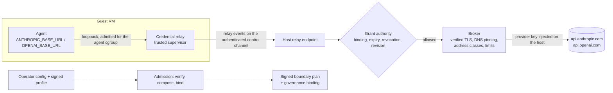

# Governed sessions

Governed sessions add operator-signed policy profiles and host-side
credential mediation on top of the existing VM isolation, signed boundary
plan, and session audit. Standalone sessions are unchanged unless governance
is selected or required by the host.

Two authorities are supported:

- **Local** (single host): the host verifies the profile and runs the grant
  authority in process. The principal is the local OS account.
- **Shared** ([`sendbox-fleet`](https://github.com/mbianchidev/sendbox-fleet)):
  an authenticated, multi-user service enforces project-scoped roles, approves
  bounded, expiring exceptions, admits sessions, issues and checks grants, and
  keeps a central, hash-chained audit log. See
  [shared governance service](#shared-governance-service).

Both share the [`sendbox-governance`](../../crates/sendbox-governance)
contract crate (contract version 2).



## Selecting governance

| Mode | How it is selected | Who may own the files |
|---|---|---|
| Managed | `/Library/Application Support/SendBox/governance.yaml` (macOS) or `/etc/sendbox/governance.yaml` (Linux) exists | root, with every ancestor root-owned and not group/world writable |
| Opt-in | `sendbox run --governance-config PATH` on a host without a managed file | root or the current user, not group/world writable |
| Standalone | neither | not applicable |

A managed configuration always wins. When it exists, every `sendbox run` is
governed and `--governance-config` is rejected if it names any other file.
There is no environment variable or project setting that disables governance
or selects another authority. If the managed path exists but cannot be read or
verified, the session fails closed.

Opt-in mode is self-governance: it lets a user apply a signed profile to their
own sessions, but the user can stop selecting it. Use managed mode when the
operator and the session user are different parties.

A standalone project that lists `credential_services` is rejected, because
brokered credentials only exist under a grant authority.

## Operator configuration

```yaml
format: sendbox.governance-operator
version: 1
authority: local
profile: acme-default
profile_path: /Library/Application Support/SendBox/profiles/acme-default.yaml
# signatures_path defaults to profile_path + ".sig.json"
minimum_revision: 3
trust:
  threshold: 1
  signers:
    - version: 1
      fingerprint: "<hex>"
      name: Acme security
      email: null
      public_key_base64: "<base64>"
      valid_from_unix: 1790000000
      expires_at_unix: null
      revoked_at_unix: null
bundle:                     # optional: pin the guest bundle trust root
  trust_root_sha256: ["<sha256 of release-public.key>"]
  trust_root_ids: [external-release-root]
  minimum_release_sequence: 7
revision_cache_seconds: 30
fleet:                      # optional: use a shared governance service
  url: https://fleet.acme.example
  token_secret: SENDBOX_FLEET_TOKEN   # host secret holding the caller's token
  timeout_seconds: 10
```

- `trust` builds a provenance trust store with `allow_unsigned: false`. At
  least `threshold` distinct, unexpired, unrevoked signers must sign the
  profile's exact bytes.
- `minimum_revision` is the operator's rollback floor. Raising it makes every
  older revision, and every grant bound to one, stale.
- `bundle` pins the `--trust-root`, `--trust-root-id`, and minimum
  `--minimum-release-sequence` a governed run may use, so a caller cannot
  substitute their own guest supervisor. In managed mode the pinned trust root
  file must be root-owned with protected ancestors, so it cannot be swapped
  between the pin check and bundle verification.
- `revision_cache_seconds` bounds how long the grant authority reuses a
  verified profile before re-reading and re-verifying it.
- `fleet` selects the [shared governance service](#shared-governance-service)
  as the authority. `authority` must then equal the service's
  `FLEET_AUTHORITY_ID` and cannot be `local`. `url` must use `https://`;
  plain `http://` is accepted only for a loopback host. `timeout_seconds` is
  1 to 60.

The host also keeps a per-user high-water mark of admitted revisions under the
runtime state directory and rejects a lower revision. That record is
user-writable; the operator `minimum_revision` is the authoritative floor.

## Profiles

Profiles are YAML documents signed byte for byte. Their digest is the SHA-256
of those bytes, so any edit is a new revision that must be signed again.

```yaml
format: sendbox.governance-profile
version: 1
id: acme-default
revision: 4
not_before_unix: 1790000000
expires_at_unix: 1810000000     # at most 400 days after not_before_unix
ceiling:
  runtimes: [apple, kata]
  images: ["sha256:<64 hex>"]   # optional; empty permits any image
  workspace_roots: [/Users]     # optional; empty permits any workspace
  resources: { max_cpus: 8, max_memory_mb: 16384 }
  commands:
    default_action: deny
    allowlist: ["/usr/local/bin/claude *", "git *", "cat *"]
  network:
    default_action: deny
    allowed_domains: ["*.github.com", "registry.npmjs.org"]
    allowed_networks: []
    allowed_ports: []            # empty permits any port
    allow_dns: true
    github_meta: false           # implicit GitHub Meta CIDR delegation
  mcp:
    require_boundaries: true
    servers: {}
  packages:
    allowed_registries: ["https://registry.npmjs.org/"]
    require_supply_chain: false
  secrets:
    workload: [NPM_TOKEN]        # names that may enter the guest
  github:
    forward_auth: false
    forward_copilot_auth: false
    allow_private_repository_access: false
    ssh_key: false
    require_branch_protection: true
    safe_outputs: { enabled: true, allow_apply: false, repositories: [] }
denials:
  commands: ["git push --force *"]
  domains: [pastebin.com]
  networks: ["169.254.0.0/16"]
credential_services:
  - id: anthropic
    provider: anthropic
    secret: SENDBOX_ANTHROPIC_API_KEY
    methods: [POST, GET]               # default: GET, POST
    path_prefixes: [/v1/messages, /v1/models]
    max_request_bytes: 8388608
    max_response_bytes: 67108864
    max_duration_seconds: 900
    idle_timeout_seconds: 120
    deny_direct_egress: true
  - id: openai
    provider: openai
    secret: SENDBOX_OPENAI_API_KEY
grants:
  lease_seconds: 300
  max_ttl_seconds: 28800
  revocation_grace_seconds: 5
  max_concurrent_streams: 8
exceptions:                    # optional: denials an approved exception may lift
  max_ttl_seconds: 86400       # at most 7 days
  commands: []
  domains: [pastebin.com]      # each entry must also be listed in denials
  networks: []
```

Omitted ceiling sections take their most restrictive value. Unknown fields are
rejected. An omitted `exceptions` section permits no exceptions; see
[exceptions](#exceptions).

### Signing workflow

```bash
sendbox governance keygen --output ~/acme-governance.key   # prints the public identity
sendbox governance sign acme-default.yaml --key ~/acme-governance.key
sendbox governance sign acme-default.yaml --key second.key --append   # threshold signing
sudo install -m 0644 -o root acme-default.yaml acme-default.yaml.sig.json \
  "/Library/Application Support/SendBox/profiles/"
sendbox governance verify
sendbox governance check --config .sendbox.yaml
```

`check` loads the active profile, applies its denials, and lists every
violation without starting a session. Keep signing keys off the managed host.

## Admission and composition

Admission runs before any side effect such as resolving GitHub credentials,
creating session state, or starting a runtime:

1. Discover the authority, load the operator configuration, check bundle pins.
2. Verify profile signatures, profile id, validity window, minimum revision,
   and the local high-water mark.
3. Append profile denials and every `deny_direct_egress` provider host to the
   session policy. Denials only add deny rules and blocked destinations.
4. Compare the effective configuration with the ceiling. Every violation is
   reported; nothing is silently narrowed.
5. Sign a governance binding into the boundary plan.

Composition is a subset check over expanded capabilities, never a merge:

| Dimension | Rule |
|---|---|
| Runtime | Must be listed. Hyperlight is always rejected because it has no persistent guest boundary. Project-selected Kata executables, handlers, or configuration are rejected. |
| Image, workspace, resources | Image digest in `images`, workspace under a `workspace_roots` entry, resources at most the maximums, when configured. |
| Commands | `allow` default requires an `allow` ceiling. Each exact rule must be matched by a ceiling rule with the runtime's own argv and basename semantics; a wildcard rule must equal a ceiling rule. |
| Domains | `allow` default requires an `allow` ceiling. Exact names need a covering pattern; `*.x` needs `*.x` or a broader `*.y`. Entries already blocked are ignored. |
| GitHub Meta | An unblocked exact `github.com` grant implicitly delegates GitHub Meta CIDRs and requires `github_meta: true`. |
| Networks and ports | Each CIDR must be contained in a ceiling CIDR. A port ceiling requires an explicit, covered port list. |
| DNS | Numeric limits at most the ceiling (defaults equal the runtime defaults), record types a subset, and the budget window equal. |
| MCP | The boundary must stay enabled when required. Legacy flat tool rules are unsupported. Each server must match a ceiling server's transport, command or URL, tools, HTTP flags, redirects, and secrets. |
| Packages | Registries, plaintext HTTP, credentials, finding overrides, and exceptions need explicit ceiling permission; inspection can be required. |
| Secrets | Workload secrets must be listed; a brokered credential or a provider endpoint variable can never be a workload secret. |
| GitHub | Token forwarding, Copilot forwarding, private access, SSH keys, disabled branch protection, and Safe Outputs apply mode or targets each need ceiling permission. |
| Credential services | Must be offered by the profile. |

Observability settings are not capabilities and are not compared.

## Binding

`BoundaryPlan.governance` records the authority (id and trust digest), the
exact profile (id, revision, SHA-256), the principal, the project, the
effective policy SHA-256, the brokered service ids, and the ids of any
exceptions the session lifted (omitted when there are none). It is omitted
from standalone plans, whose canonical bytes are unchanged. The effective
policy digest must equal the plan's `policy_sha256`, which secret envelopes
already authenticate. A local authority uses `local-user:<uid>` as the
principal; a shared service uses the principal it authenticated. The project
is `github:<owner>/<repository>` (or a workspace path digest).

## Brokered credentials

A project requests services by profile id:

```yaml
credential_services: [anthropic]
```

The host resolves each provider credential from the host secret store before
the session starts (`sendbox secrets add SENDBOX_ANTHROPIC_API_KEY`) and keeps
it in the host process. It is never part of the boundary plan, bootstrap,
secret envelopes, guest environment, or audit. The guest receives only:

| Provider | Base URL variable | Key variable |
|---|---|---|
| `anthropic` | `ANTHROPIC_BASE_URL=http://127.0.0.1:15084/<id>` | `ANTHROPIC_API_KEY=sendbox-brokered-credential` |
| `openai` | `OPENAI_BASE_URL=http://127.0.0.1:15084/<id>/v1` | `OPENAI_API_KEY=sendbox-brokered-credential` |

The key value is a fixed placeholder that the broker discards. Policies
describe services, not agents: any agent or SDK that honors these variables
works, including Claude Code and Codex.

### Compatibility contract

- The client must support an explicit base URL and append the upstream path.
- Request bodies need `Content-Length`; chunked uploads are rejected.
- Clients that hardcode their service origin or require HTTPS proxy tunneling
  are unsupported. SendBox never falls back to delivering the raw credential,
  intercepting TLS, or executing on the host.

### Relay

The trusted guest supervisor listens on `127.0.0.1:15084`; when egress is
enforced, nftables admits that port only for the agent cgroup. A request to
`/<service>/<path>` becomes one relay stream on the authenticated control
channel. The guest drops `authorization`, `x-api-key`, `cookie`, and forwarding
headers, and the host additionally forwards only the provider's header
allowlist.

The host checks method and path locally, asks the grant authority, injects the
credential (`x-api-key` for Anthropic, `Authorization: Bearer` for OpenAI),
and sends the request with the existing broker transport: verified HTTPS on
port 443, DNS resolved and classified per request, addresses pinned, no
system proxy, and redirects denied. Responses stream back as they arrive,
including server-sent events. The guest grants one credit per chunk written
to the agent and the host never exceeds 16 outstanding 32 KiB chunks, so a
slow agent cannot stall terminal or control traffic. Limits per service bound
request size, response size, total duration, and idle time; a stream whose
upstream or guest credit stays idle longer than `idle_timeout_seconds` fails.
When the agent disconnects or the guest stops reading a stream, the guest
tells the host so it closes the upstream connection.

## Grants and revocation

At session start the grant authority issues one grant per brokered
service, bound to the principal, project, session, binding digest, profile
revision, methods, path prefixes, a renewable lease, and a hard maximum
lifetime. Every request is checked for:

- an existing, unrevoked grant with an unexpired lease and lifetime;
- the exact principal, project, session, and binding digest from trusted host
  state (workload-supplied identity is never consulted);
- the granted service, method, and segment-aware path prefix (encoded
  separators and dot segments are rejected);
- a profile revision that is still the operator's current, verified revision
  and not below the minimum.

An unreadable or unverifiable profile denies with `authority_unavailable`. The
host renews leases at a third of the lease length. When a grant's renewal
fails, new requests for that service are denied and its in-flight streams get
`revocation_grace_seconds` to finish before they are cancelled and the agent
sees the stream end with `grant_lapsed`. Streams of other services are not
affected. Streams are authorized once at start and are
otherwise bounded by `max_duration_seconds`.

When the workload ends, is cancelled, or fails, the relay stops accepting
requests, aborts in-flight streams, and revokes every grant. A stream that was
already sent upstream is recorded as `aborted_uncertain`: SendBox does not
claim that revocation reverses completed external effects.

## Audit

Records join the existing signed session audit chain:

| Action | Recorded when |
|---|---|
| `governance.admission.accepted` | the session starts under a profile |
| `credential.grant.issued`, `.lapsed`, `.revoked` | grant lifecycle |
| `credential.request.allowed`, `.denied` | each authorization decision |
| `credential.request.outcome` | each stream ends, with status, byte counts, duration, and outcome |
| `governance.exception.expired` | a lifted exception expired and the session was stopped |
| `credential.request.outcome_report_failed` | a stream outcome could not be reported to the shared service |

Each record carries principal, project, session, authority, profile id,
revision and digest, effective policy digest, and binding digest. The
admission record also lists each lifted exception with its scope, requester,
approver, and expiry, and the service URL when a shared service is used. Request
records add the service, method, path without query, and reason. Credentials,
headers, query strings, and request or response bodies are never recorded. A
failure to record relay evidence fails the run.

## Shared governance service

With `fleet` in the operator configuration, the host uses
[`sendbox-fleet`](https://github.com/mbianchidev/sendbox-fleet) as its
authority. The profile is still read from `profile_path` and verified against
the operator's `trust` signers on the host; the service separately verifies the
same signed bytes when an operator publishes them, and only admits sessions
bound to its current revision.

```mermaid
sequenceDiagram
  participant H as SendBox host (caller's token)
  participant F as sendbox-fleet
  H->>F: GET /v1/whoami
  F-->>H: principal (becomes the session principal)
  H->>F: GET /v1/exceptions?project=…&state=active
  Note over H: lift only approved exceptions for this principal,<br/>project, and exact profile revision; check the ceiling
  H->>F: POST /v1/sessions:admit (session, binding)
  Note over F: caller = binding principal, role ≥ member,<br/>current revision, every exception still valid
  H->>F: POST /v1/grants · /v1/authorize · :renew
  H->>F: POST /v1/sessions/{id}:end (revokes remaining grants)
```

- **Authentication.** The caller stores a service token in the host secret
  store under `token_secret` (default `SENDBOX_FLEET_TOKEN`). With an
  identity provider, `sendbox governance login` exchanges an OIDC token for a
  short-lived service token and stores it:

  ```bash
  my-idp print-id-token | sendbox governance login   # or --identity-token-file PATH
  ```

  The service URL comes only from the verified operator configuration.
  Tokens can also be issued by the service operator and added with
  `sendbox secrets add SENDBOX_FLEET_TOKEN`. A token is sent only to the
  configured URL, redirects are never followed, system proxies are ignored,
  and it can never be a workload secret.
- **Identity.** The authenticated principal, not the local account, is the
  session principal. The service refuses a binding whose principal is not the
  caller, so a host cannot claim another identity.
- **Roles.** Admission needs the `member` role or higher in the project.
  Roles, exceptions, and audit are managed through the service; see its
  [architecture](https://github.com/mbianchidev/sendbox-fleet/blob/main/docs/architecture.md).
- **Grants.** The service is the grant authority. Every brokered request is
  authorized by the service; any non-200 answer, timeout, or unreachable
  service denies with `authority_unavailable`. Nothing falls back to the
  local authority or to credential delivery.
- **Outcomes.** When a brokered stream ends, the host reports its redacted
  outcome (`succeeded`, `failed`, or `unknown` when a stream was cut after
  reaching the provider) to the service, which records it in the central
  audit. Reports are sent in order and flushed before grants are revoked; a
  report that fails is recorded as `credential.request.outcome_report_failed`
  in the session audit, which keeps the authoritative local record.
- **End.** After the workload ends, the host revokes its grants and ends the
  session on the service, which revokes any grant still live.

### Exceptions

An exception lifts exactly one profile denial for a project, or for one
principal in it, until it expires (at most 7 days). Only denials the operator
listed under the profile's `exceptions` section can be lifted, so the
operator's signed opt-in bounds every exception. Lifting a denial never adds a
capability: the session must still fit the ceiling, and provider hosts blocked
for brokered services are never lifted.

A project member requests an exception against the current profile revision;
a different principal with the `owner` or `admin` role approves it. The host
lifts a denial only for an approved, unrevoked, unexpired exception bound to
the exact revision it runs under, binds its id into the signed boundary plan,
and the service re-checks it at admission. A new revision or a raised minimum
revision makes the approval stale, so it can no longer admit sessions.

Egress and command rules are fixed when the VM starts, so the host stops the
session when the earliest lifted exception expires
(`governance.exception.expired`, exit code `6`). Like any failed run, the
workspace is rolled back to its starting snapshot, so request an expiry that
covers the work. Grants are capped at that
expiry, and once an exception is revoked the service denies the session's
brokered requests and lease renewals with `stale_policy`. Revocation does not
reach into the VM's egress rules: a revoked exception's lifted denial stays
lifted until the session ends or the exception's original expiry stops it.

## Trust boundaries and residual risks

- The local user who owns the host secret store can still read their own
  provider key on the host. The guarantee is that the agent and guest never
  receive it.
- Opt-in governance is chosen by the user and is not an enforcement boundary
  against that user.
- The local revision high-water mark is user-writable; rely on
  `minimum_revision` for rollback protection.
- Long-running streams are not re-authorized mid-stream.
- With `deny_direct_egress: false` and permissive network policy, a workload
  that has its own provider key could still call the provider directly. Keep
  the default to block the provider host for the workload.

- A shared service that is compromised can authorize misuse but never sees
  provider keys; the host broker keeps them. A compromised host is limited to
  sessions and grants issued to the principals whose tokens it holds.
- The fleet token is a bearer credential for its principal. Keep token
  lifetimes short; revoke tokens and disable principals in the service.
- `sendbox governance check` evaluates the local profile only and does not
  consult the service for exceptions.

Non-goals: Kubernetes or fleet scheduling, universal TLS interception, formal
policy verification, model API translation, and replacing isolation
providers.
